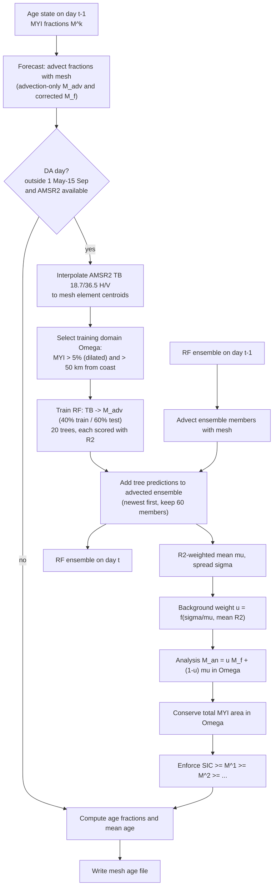

# Sea Ice Age with Data Assimilation (SIAge-DA)
## Algorithm Theoretical Basis Document — Data Assimilation Component

| | |
|---|---|
| Product | NERSC Arctic 25 km Sea Ice Age with data assimilation (`NERSC_arctic25km_sea_ice_age_DA`) |
| Algorithm | Lagrangian triangular-mesh SIAge (v2.x) + ensemble Random-Forest data assimilation of passive-microwave observations |
| Reference configuration | `da5l` |
| Reference implementation | `04find_autumn_minima_DA.ipynb`, `05compute_age_DA_v5_advect_prev_rf_ens.ipynb` |
| Document version | 0.1 (draft), 2026-11-19 |

---

## Contents

1. [Introduction](#1-introduction)
2. [Motivation for data assimilation](#2-motivation-for-data-assimilation)
3. [Algorithm overview](#3-algorithm-overview)
4. [Input data](#4-input-data)
5. [Algorithm description](#5-algorithm-description)
6. [Seasonal operation](#6-seasonal-operation)
7. [Configuration parameters](#7-configuration-parameters)
8. [Output](#8-output)
9. [Assumptions, uncertainties and limitations](#9-assumptions-uncertainties-and-limitations)
10. [References](#10-references)
- [Appendix A. Development history of the DA scheme](#appendix-a-development-history-of-the-da-scheme)
- [Appendix B. Notation](#appendix-b-notation)

---

## 1. Introduction

### 1.1 Purpose and scope

This document gives the theoretical basis of the **data assimilation (DA)** component of the NERSC Lagrangian sea ice age algorithm (SIAge). The core of the algorithm is documented elsewhere (Korosov et al., 2018; Korosov et al., 2026) and is only summarised here:

* **Preprocessing.** OSI SAF sea ice drift (SID) and sea ice concentration (SIC) are collocated and reprojected onto the EASE2 25 km grid.
* **Mesh advection.** A triangular mesh is advected daily with the SID. It is remeshed when needed, and conservative remapping weights connect the elements of consecutive days.
* **Age computation.** On 15 September each year a new multi-year ice (MYI) "fraction" is initialised. The fraction is propagated forward with the mesh and constrained by observed SIC. The differences between the fractions of consecutive years give the age fractions, and their weighted sum gives the mean ice age.

This document covers what the DA version adds to, or changes in, that chain:

* the initialisation of the MYI fraction on 15 September;
* the removal of coastal ice near the summer minimum;
* the daily assimilation of AMSR2 brightness temperatures into the most recent MYI fraction;
* the steps that keep the age fractions conserved and consistent after the analysis.

### 1.2 Concept in one paragraph

The Lagrangian model gives a forecast of MYI concentration that is physically consistent but accumulates errors from drift and SIC uncertainty. Passive-microwave brightness temperatures (TB) carry an independent but ambiguous signature of MYI. The DA scheme does **not** use an external MYI retrieval. Each day it trains a Random Forest (RF) regression that maps TBs to the model's own MYI forecast. The RF can only reproduce the parts of the forecast that are explained by the radiometric signal, so its prediction acts as a *pseudo-observation*: the forecast projected onto the space of fields the satellite can explain. RF predictions from the trees of the current day and from the previous days, advected with the mesh, form a time-lagged ensemble. The ensemble mean is the pseudo-observation. Its spread, combined with the out-of-sample RF skill, sets the observation weight. The forecast is nudged toward the ensemble mean with that weight, the total MYI area is conserved, and the older age fractions are made consistent with the updated MYI.

---

## 2. Motivation for data assimilation

The non-assimilative SIAge algorithm has error sources that grow in time:

1. **Drift errors.** Errors in the SID displace the MYI edge. They accumulate over the 7.5 months between freeze-up and melt onset, and over several years for the older fractions.
2. **Concentration errors.** MYI is capped by the observed total SIC, so any SIC underestimate (thin ice, melt ponds, weather contamination) removes MYI permanently.
3. **Initialisation errors.** MYI is defined as the ice that survived the summer minimum. Ice that forms in early freeze-up, or fast and coastal ice in the peripheral seas, may be wrongly labelled as MYI.
4. **Unresolved processes.** Ridging, export through narrow straits and sub-grid deformation are only partly represented by the mesh advection.

Over cold, dry winter snow, the passive-microwave signature separates first-year ice (FYI) from MYI. MYI has a lower emissivity at 36.5 GHz and a larger 18.7–36.5 GHz gradient, because of volume scattering in the desalinated upper layer. This signature gives an independent daily constraint on where MYI is. It is ambiguous, though. It saturates, it changes with snow and weather, and it is unusable during melt. The DA combines the two sources so that the Lagrangian model supplies the age bookkeeping and spatial continuity, and the TBs correct the MYI distribution.

---

## 3. Algorithm overview

The DA is a sequential, daily filter. Only the **most recent MYI fraction** is assimilated, that is, the ice that survived the last summer minimum. This fraction is the total MYI concentration (second-year ice and older), which is the quantity the microwave signature can separate from FYI. The older fractions are corrected only through the consistency constraint (Section 5.10).

---

## 4. Input data

| Input | Source | Use in DA |
|---|---|---|
| Advected mesh files (`mesh_YYYYMMDD.zip`): node coordinates, triangles, remapping indices `src2dst` and weights, element area ratio, SIC on elements | Standard SIAge preprocessing and mesh advection (shared with the v2.x product) | Forecast step, advection of the RF ensemble, observed SIC cap |
| Previous-day age state (`age_YYYYMMDD.zip`): MYI fractions `sicYYYY0915` | Output of the previous DA cycle | Background state |
| AMSR2 brightness temperatures, evening overflight: 18.7 GHz H/V and 36.5 GHz H/V (`AMSR2_TB18.7H_E`, `AMSR2_TB18.7V_E`, `AMSR2_TB36.5H_E`, `AMSR2_TB36.5V_E`) | Round Robin Data Package for Sea Ice Types (RRDP `s_rrdp_v02_fv01`), 25 km EASE2 LAEA north grid, daily | Predictors of the RF |
| Distance to coast (0.04° global grid) | Static auxiliary field | Excludes coastal elements from training and update; removes coastal ice near the minimum |
| Land and ocean masks of the EASE2 25 km mesh grid | Static auxiliary field | Output masking |

The RRDP also provides all 12 AMSR2 evening channels and ASCAT backscatter. Experiments `da5a`–`da5j` used these 13 predictors. The reference configuration uses only the four 18.7/36.5 GHz channels (Section 7.2). These channels carry the main FYI/MYI contrast, and the lower and higher frequencies add little to it while being more sensitive to atmosphere and surface.

AMSR2 data start in July 2012, so DA is active from the 2012/2013 freeze-up onward.

---

## 5. Algorithm description

### 5.1 State and notation

The state is defined on the elements $i$ of the advected triangular mesh on day $t$:

* $C_t(i)$: observed total SIC (%), interpolated to the mesh.
* $M^k_t(i)$: MYI fraction $k$ (%), that is, the concentration of ice that has survived at least $k$ summer minima. $k=1$ is the most recent fraction, initialised on the latest 15 September. At most the six most recent fractions are kept.

The fractions satisfy $C_t \ge M^1_t \ge M^2_t \ge \dots \ge 0$.

### 5.2 Initialisation of the MYI fraction on 15 September

On 15 September of year $Y$, a new fraction $M^1$ (named `sicY0915`) is created. In the DA version this fraction is the **observed SIC on 15 September**. The standard product instead uses the minimum of SIC advected over 5–15 September. Using the observed SIC can label some newly formed ice as MYI. The DA cycles that follow from 16 September are expected to remove that ice wherever the radiometric signature does not support it.

### 5.3 Forecast step

The remapping operator $\mathcal{A}_t$ moves an element field from the mesh on day $t-1$ to the mesh on day $t$:

$$
(\mathcal{A}_t\,x)(i) = \sum_{j\to i} w_{ji}\, x(j),
$$

The sum runs over the source elements $j$ connected to the destination element $i$ by `src2dst`, with remapping weights $w_{ji}$. The forecast step computes two versions of each fraction:

* **Advection-only forecast**, used as the RF training target:
  $$M^{k,\mathrm{adv}}_t = \mathrm{clip}\big(\mathcal{A}_t M^k_{t-1},\,0,\,100\big)$$
* **Full forecast (background)**, corrected for element area change $r_t$ (ratio of new to old element area) and capped by observed SIC:
  $$M^{k,f}_t = \min\Big(\mathrm{clip}\big(\mathcal{A}_t M^k_{t-1}/r_t,\,0,\,100\big),\; C_t\Big)$$

The RF is trained on the advection-only field because the full forecast contains the SIC cap, and the SIC cap would add the SIC retrieval's own TB dependence to the RF target.

### 5.4 Removal of coastal ice near the summer minimum

Between 15 August and 16 September, $C_t$ and all $M^k_t$ are set to zero in elements that meet both of these conditions:

* the element is less than 40 km from the coast;
* the element lies in the peripheral part of the domain, defined as the elements whose distance from a reference point at $(x,y)=(-600,-200)$ km (EASE2 LAEA) is within 1000 km of the largest such distance.

This removes fast and coastal ice on the Eurasian and Alaskan shelves before the new fraction is initialised, so that it does not become spurious MYI. The coasts of the Canadian Arctic Archipelago and northern Greenland, where coastal MYI is genuine, lie close to the reference point and are kept.

### 5.5 Observation operator

The four TB channels $\mathbf{T}_t$ are interpolated from the 25 km RRDP grid to the element centroids of the day-$t$ mesh by linear interpolation on the Delaunay triangulation of the grid nodes:

$$
\mathbf{y}_t(i) = \mathcal{H}_t(\mathbf{T}_t)(i) \in \mathbb{R}^4 .
$$

The DA is not performed on day $t$ if no RRDP file exists for that day.

### 5.6 Training and update domain

The RF is trained, and the analysis applied, only in the domain

$$
\Omega_t = \mathcal{D}^5\big(\{i : M^{1,\mathrm{adv}}_t(i) > 5\%\}\big) \;\cap\; \{i : d_\mathrm{coast}(i) > 50\ \mathrm{km}\},
$$

where $\mathcal{D}^5$ is a dilation by five rings of neighbouring triangles, about 100–150 km. The dilation adds FYI around the MYI pack to the training sample, so the RF sees both classes and the update can also move the MYI edge outward. The coastal exclusion avoids land-spillover contamination of the TBs.

### 5.7 Random Forest regression (pseudo-observation)

The pairs $\{(\mathbf{y}_t(i),\, M^{1,\mathrm{adv}}_t(i)) : i\in\Omega_t\}$ are split at random into 40% training and 60% testing samples. A pipeline of feature standardisation and a Random Forest regressor is fitted to the training samples:

| RF hyper-parameter | Value |
|---|---|
| number of trees $N_\mathrm{tree}$ | 20 |
| max depth | 20 |
| min samples to split | 5 |
| min samples per leaf | 1 |
| bootstrap sample fraction | 0.3 |

Every tree $m$ is treated as a separate ensemble member. Its out-of-sample skill $R^2_{t,m}$ is computed on the test samples, and its prediction is evaluated over the whole domain:

$$
p_{t,m}(i) = \begin{cases} f_{t,m}(\mathbf{y}_t(i)) & i\in\Omega_t \\ 0 & \text{otherwise.} \end{cases}
$$

**Why this works.** The RF learns the conditional expectation $\mathbb{E}[M^{1,\mathrm{adv}} \mid \mathbf{y}]$ over the whole basin. Model errors that are not correlated with the TBs, such as a misplaced MYI tongue caused by drift error, cannot be represented by this mapping, and they average out of the prediction. In the misplaced region the prediction follows the radiometric evidence. The approach needs no in-situ or ice-chart training data and adapts by construction to seasonal changes of the TB signature (snow metamorphism, temperature). Its limitation is that it cannot fix a bias that exists over the whole basin (Section 9).

### 5.8 Time-lagged advected ensemble

A single day's RF is noisy because of TB noise, weather effects and swath artefacts. The pseudo-observation is therefore an ensemble of current and past RF predictions:

1. Every member of the previous day's ensemble is advected with the same operator as the state, $p \leftarrow \mathcal{A}_t\, p$, and keeps its original skill score.
2. The $N_\mathrm{tree}=20$ new members of day $t$ are put at the front of the ensemble.
3. On DA days the ensemble is cut to the $N_\mathrm{ens}=60$ newest members, about the last three DA days.

The ensemble members are advected without the area correction and without the SIC cap. On days without DA, the ensemble is still advected but not renewed. The ensemble is emptied on 15 and 16 September, when a new MYI fraction is initialised.

Because older RF predictions are moved along with the ice, this ensemble is a time-lagged, Lagrangian ensemble. It smooths the daily RF noise without blurring features that move with the ice.

### 5.9 Ensemble statistics and observation weight

**Ensemble mean.** The mean is the skill-weighted average over the members with non-negative skill:

$$
\mu_t(i) = \frac{\sum_{m:\,R^2_m\ge 0} R^2_m\, p_m(i)}{\sum_{m:\,R^2_m\ge 0} R^2_m}.
$$

**Ensemble spread.** $\sigma_t(i)$ is the standard deviation of all members.

**Daily skill.** $\bar R^2_t$ is the mean skill of the 20 trees of the current day.

**Background weight.** The weight $u_t\in[0,1]$ of the forecast is

$$
u_t(i) = \begin{cases}
\mathrm{clip}\!\left(a\,\dfrac{\sigma_t(i)}{\mu_t(i)}\,\big(\bar R^2_t\big)^{\gamma} + b,\; 0,\; 1\right) & \bar R^2_t > 0 \text{ and } \mu_t(i)\ge 5\% \\[2ex]
1 & \text{otherwise}
\end{cases}
$$

with $a=1$ (`var_factor`), $b=0.3$ (`var_offset`) and $\gamma=-2$ (`r2_factor_power`).

The terms have these meanings:

* $\sigma/\mu$, the coefficient of variation of the ensemble, measures the local uncertainty of the pseudo-observation. Where the members disagree, the model forecast is trusted more.
* $(\bar R^2)^{-2}$ inflates the uncertainty on days when the RF explains the forecast poorly, because of weather or the TB signature. For example, $\bar R^2 = 0.7$ doubles the relative spread.
* $b$ is a floor on the forecast weight. At most $1-b=70\%$ of the innovation is taken in one cycle, which keeps the pull toward the observations gradual and stable over repeated daily updates.
* No update is made where the predicted MYI is below 5%. There the coefficient of variation is undefined and the RF output is dominated by FYI noise.

### 5.10 Analysis update

The analysis of the most recent fraction is

$$
M^{1,a}_t(i) = \begin{cases}
\max\!\big(0,\; u_t(i)\,M^{1,f}_t(i) + \big(1-u_t(i)\big)\,\mu_t(i)\big) & i\in\Omega_t \\
M^{1,f}_t(i) & i\notin\Omega_t .
\end{cases}
$$

This is a scalar, element-wise Kalman-type update with gain $K_t = 1-u_t$. Here $u_t$ plays the role of $\sigma_o^2/(\sigma_b^2+\sigma_o^2)$, with the observation-error term estimated from the RF ensemble. No spatial covariance is used explicitly. The spatial structure of the increments comes from the RF prediction itself and from the advected ensemble.

### 5.11 Conservation of MYI area

The DA must move MYI to where the satellite places it, but it should not create or destroy MYI in net, because the MYI budget is controlled by the summer minimum and by export. On the valid set

$$
V_t = \Omega_t \cap \{0 < M^{1,f}_t < 100\} \cap \{0 < M^{1,a}_t < 100\},
$$

the analysis is rescaled so that its total matches the forecast:

$$
M^{1,a}_t(i) \leftarrow M^{1,a}_t(i)\,\frac{\sum_{j\in V_t} M^{1,f}_t(j)}{\sum_{j\in V_t} M^{1,a}_t(j)}, \quad i\in V_t .
$$

The sums are taken over elements. The mesh is close to equal-area (25 km EASE2 seeds with bounded area change), so these sums approximate the MYI area. Elements at 0% or 100% are left out, so that saturated or ice-free elements are not rescaled.

### 5.12 Consistency of age fractions

After the update, the ordering of the fractions is restored by clipping each fraction from the top down:

$$
M^{1}_t \leftarrow \min(M^{1}_t, C_t), \qquad M^{k}_t \leftarrow \min(M^{k}_t, M^{k-1}_t),\quad k = 2,\dots
$$

A decrease of MYI caused by the DA is therefore passed on to the older fractions. An increase is not, because the older fractions cannot be inferred from the TBs.

### 5.13 Age fractions and mean age

As in the standard algorithm, the fractions are differenced to give the concentrations of ice in each age class:

$$
F_t = \mathrm{diff}\big([\,0,\; M^{K}_t,\dots,M^{1}_t,\; C_t\,]\big),
$$

and the mean age is computed as

$$
A_t = \frac{1}{100}\sum_n F^n_t \,\big(n-1+\delta_t\big),
$$

where $\delta_t$ is the time elapsed since the last 15 September, in years.

---

## 6. Seasonal operation

| Period (destination date) | Forecast | RF ensemble | DA update |
|---|---|---|---|
| 15–16 Sep | New fraction initialised from observed SIC | Emptied | – |
| 16 Sep – 30 Apr | Yes | Advected, renewed with 20 trees per day, cut to 60 | **Yes**, if AMSR2 is available |
| 1 May – 15 Sep | Yes | Advected only, not renewed | No: melt-season TBs (wet snow, melt ponds) do not separate ice types |
| 15 Aug – 16 Sep | Coastal ice removal in the peripheral seas (Section 5.4) | – | – |

The run starts from the state of the standard product (reference run `da5l`: state on 31 December 2011). DA becomes active with the first freeze-up that has AMSR2 coverage (16 September 2012).

---

## 7. Configuration parameters

### 7.1 Reference configuration (`da5l`)

| Parameter (code name) | Symbol | Value | Meaning |
|---|---|---|---|
| `MAX_LEN_FRACTIONS` | $K$ | 6 | Number of most recent MYI fractions kept |
| `min_myi_pred` | – | 5 % | Threshold on advected MYI that defines the core of $\Omega$ |
| (fixed) | $\mathcal{D}^5$ | 5 rings | Dilation of the MYI mask |
| `min_dist` | – | 50 km | Minimum distance to coast for training and update |
| `erase_coast_sic` | – | True | Coastal ice removal 15 Aug–16 Sep (< 40 km from coast, peripheral region) |
| `only_36_18` | – | True | Use only AMSR2 18.7/36.5 GHz H/V as predictors |
| `n_estimators` | $N_\mathrm{tree}$ | 20 | Trees per daily RF, that is, new ensemble members per day |
| `rf_ens_max_size` | $N_\mathrm{ens}$ | 60 | Maximum size of the time-lagged ensemble |
| `weighted_myi_pred_mean` | – | True | $R^2$-weighted ensemble mean |
| `weighted_myi_pred_std` | – | False | Unweighted ensemble spread; minimum skill threshold 0 |
| `var_factor` | $a$ | 1 | Scale of the relative spread in $u$ |
| `var_offset` | $b$ | 0.3 | Minimum forecast weight |
| `r2_factor_power` | $\gamma$ | −2 | Skill penalty exponent |
| `mask_mesh_only` | – | True | Apply the analysis only in $\Omega$ |
| `apply_myi_area_correction` | – | True | Conserve MYI area (Section 5.11) |
| `start_15_sep` | – | False | Restart from the beginning of the record, not from the last available state |
| test fraction | – | 0.6 | Share of $\Omega$ used to score the trees |

### 7.2 Sensitivity experiments

| Experiment | Changes relative to the previous / key settings |
|---|---|
| `da5a` | Baseline. Initialisation from the minimum of advected SIC capped by SIC of 10–15 Sep; 2 trees, ensemble of 2, unweighted mean, $a=2$, $b=1$ |
| `da5b` | Initialisation from observed SIC on 15 Sep |
| `da5c` | Initialisation from the median of advected SIC capped by observed SIC, 10–15 Sep |
| `da5d` | 20 trees, ensemble of 60, $R^2$-weighted mean, $b=0.5$ |
| `da5e` / `da5f` | $a = 1$ / $a = 0.5$ |
| `da5g` | MYI threshold for $\Omega$ lowered to 1% |
| `da5h` | MYI area conservation switched on |
| `da5i` / `da5j` | $b = 0.4$ / $b = 0.3$ |
| `da5k` | Predictors limited to AMSR2 18.7/36.5 GHz H/V (13 → 4 predictors) |
| `da5l` | As `da5k`, run from the start of the record (**reference**) |

Note that with $b=1$ (`da5a`–`da5c`) the background weight is always 1, so those runs have no effective update. They serve as non-assimilative controls for the same processing chain.

---

## 8. Output

**Mesh age files** (`age_da_<exp>/YYYY/age_YYYYMMDD.zip`, daily). These contain the MYI fractions `sicYYYY0915` after DA, the age-class concentrations `f`, and the mean age `age` on the advected mesh. They are gridded to the 25 km EASE2 grid and written to NetCDF in the same way as the standard product.

**Diagnostic NetCDF files** (`collocated_<exp>/YYYY/age_da_YYYYMMDD.nc`, DA days only), on the 25 km RRDP grid:

| Variable | Description | Units |
|---|---|---|
| `lm_myi` | MYI concentration after DA (most recent fraction) | % |
| `lm_fyi` | FYI concentration after DA, $C - M^1$ | % |
| `rf_myi` | Prediction of the day's RF applied to all grid cells, including outside $\Omega$ | % |

In `lm_myi` and `lm_fyi`, −1 marks cells outside the processing mask and −2 marks land.

---

## 9. Assumptions, uncertainties and limitations

1. **Self-referential training.** The RF target is the model forecast. Errors of the model that are basin-wide and correlated with the TBs (for example a systematic over-estimate of MYI concentration at a given TB) are learned and cannot be corrected. The DA corrects the *spatial distribution* of MYI, and the area conservation (Section 5.11) explicitly keeps the MYI total from the Lagrangian budget.
2. **TB ambiguity.** Deformed FYI, wind-packed or wet snow, and thin-ice regimes can resemble MYI at 18.7/36.5 GHz. The weighting by spread and skill reduces but does not remove this effect. Updates are suppressed in summer and near the coast.
3. **Only the newest fraction is observed.** Older fractions (third-year ice and older) are corrected only downward, through the consistency constraint. An increase of $M^1$ is not passed to $M^{2..K}$.
4. **No explicit spatial error covariance.** The update is element-wise. Spatial coherence comes from the RF prediction and from the advected ensemble.
5. **Heuristic error model.** The background weight $u$ is an empirical function, tuned through the experiments in Section 7.2. It is not a formally derived error variance. The ensemble spread under-represents structural RF error, and members from previous days are treated as independent of the current day's members.
6. **Advected ensemble.** The past RF members are advected with the same drift as the state, so drift errors are correlated between the background and the pseudo-observation.
7. **Coastal zones.** Elements within 50 km of the coast are never updated. Coastal MYI (CAA, northern Greenland) therefore depends entirely on the Lagrangian forecast.
8. **Data gaps.** Days without AMSR2 data are forecast-only. The ensemble continues to advect, so the next DA day uses aged members.
9. **Uncertainty product.** The per-element uncertainty propagation of the standard product (drift and SIC uncertainty) has not yet been extended to include the DA increment. The DA diagnostics ($\mu$, $\sigma$, $u$, increment) can be exported for this purpose.

---

## 10. References

* Breiman, L.: Random Forests, Machine Learning, 45, 5–32, https://doi.org/10.1023/A:1010933404324, 2001.
* Evensen, G.: Data Assimilation: The Ensemble Kalman Filter, 2nd edn., Springer, https://doi.org/10.1007/978-3-642-03711-5, 2009.
* Korosov, A. A., Rampal, P., Pedersen, L. T., Saldo, R., Ye, Y., Heygster, G., Lavergne, T., Aaboe, S., and Girard-Ardhuin, F.: A new tracking algorithm for sea ice age distribution estimation, The Cryosphere, 12, 2073–2085, https://doi.org/10.5194/tc-12-2073-2018, 2018.
* Korosov, A., Edel, L., Regan, H., Lavergne, T., Aaboe, S., and Down, E. J.: A climate data record of sea ice age using Lagrangian advection of a triangular mesh, Earth Syst. Sci. Data, 18, 721–740, https://doi.org/10.5194/essd-18-721-2026, 2026.
* Lavergne, T., et al.: Version 2 of the EUMETSAT OSI SAF and ESA CCI sea-ice concentration climate data records, The Cryosphere, 13, 49–78, https://doi.org/10.5194/tc-13-49-2019, 2019.

---

## Appendix A. Notation

| Symbol | Meaning |
|---|---|
| $i$ | Mesh element index |
| $t$ | Day |
| $C_t$ | Observed total SIC on the mesh (%) |
| $M^k_t$ | MYI fraction $k$ (ice that survived $\ge k$ minima) (%) |
| $M^{1,\mathrm{adv}}_t$ | Advection-only forecast of the newest fraction (RF target) |
| $M^{1,f}_t$, $M^{1,a}_t$ | Forecast (background) and analysis of the newest fraction |
| $\mathcal{A}_t$ | Mesh remapping (advection) operator |
| $r_t$ | Element area ratio |
| $\mathcal{H}_t$ | Interpolation of gridded TB to element centroids |
| $\mathbf{y}_t$ | TB predictor vector (18.7H, 18.7V, 36.5H, 36.5V) |
| $\Omega_t$ | Training and update domain |
| $p_{t,m}$, $R^2_{t,m}$ | Prediction and out-of-sample skill of ensemble member $m$ |
| $\mu_t$, $\sigma_t$ | Ensemble mean (skill-weighted) and spread |
| $\bar R^2_t$ | Mean skill of the current day's trees |
| $u_t$ | Background (forecast) weight; $1-u_t$ is the gain |
| $a$, $b$, $\gamma$ | `var_factor`, `var_offset`, `r2_factor_power` |
| $F_t$, $A_t$ | Age-class concentrations and mean age |
